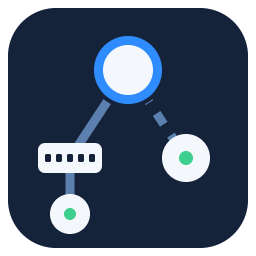

# ioBroker.unifi-map

[](LICENSE)


German documentation: [docs/de/README.md](docs/de/README.md)

ioBroker adapter for UniFi networks: are all devices running, which uplink is slow, which device restarted.
Includes a topology map as admin tab. The adapter only reads: an available firmware update is shown, it is started in the UniFi app.

> **Work in progress.** Version 0.1.0 reads status and topology and shows the map (phases 2 to 4 of 6). Nothing is written to the console.

### Features
- Status of every UniFi device (console, switches, access points): online, firmware, uptime, clients
- Uplink per device: cable or mesh, link speed, signal of mesh links
- Yellow when a cable uplink gets slower than usual (usual = fastest speed seen so far, kept in `info.linkSpeeds`); links that always ran slow stay green. The button `acceptLinkSpeeds` takes the current speeds as usual (e.g. after changing a cable)
- Restart detection, also for restarts while the adapter was stopped; restarts within 7 days
- Summary for a tile: `ok`, `degraded`, `offline`, `stale` (data too old - never green from old values)
- Topology: who is connected to whom, cable or mesh, as JSON for the map
- Admin tab **Network**: map of the network from the console downwards, live. Cable grey, mesh blue dashed, a section that is not UniFi (simple switch, powerline) orange dotted; port and speed at each link. Failed devices red, devices behind them grey dashed, updates marked. Tap a device for details (model, link, uptime, firmware, clients, IP)
- A failure is reported only for its cause: devices cut off behind a failed device are marked as a consequence.
  Devices that find another way (a mesh access point moving to another parent) count as online and report `uplinkChanged`
- Last event (offline, online, restart, uplinkChanged, degraded, recovered) as JSON for scripts

### Requirements
- A UniFi console with UniFi OS and UniFi Network 9.3 or newer (tested with a UDR and Network 10.6.109)
- An API key of a local user with a **read-only** role
- js-controller 6.0.11 or newer, admin 7.6.20 or newer, Node.js 22 or newer

### Installation
The adapter is not listed in the ioBroker repositories yet. Install it from GitHub:
```bash
iob url https://github.com/Sven-83/ioBroker.unifi-map
```

### Configuration
| Setting | Meaning |
|---|---|
| Address of the console / port | IP address or host name of the console, port 443 |
| API key | Created in UniFi under Settings > Control Plane > Integrations for a local user with a read-only role; stored encrypted |
| Fetch certificate | Reads the self-signed certificate of the console and shows its SHA-256 fingerprint. Compare it with the fingerprint your browser shows for the console, then save. Only this certificate is accepted afterwards; the key is never sent over another connection |
| Device list every | Seconds, 30 to 3600, default 60 |
| Details, clients and uplinks every | Seconds, 60 to 3600, default 300; also at once when a device changes its state |
| Name of a section without UniFi | e.g. `Powerline` or the name of a simple switch; the map shows it instead of "Not UniFi". The cable into the section is drawn as a normal cable, the way through it orange dotted |

### States
| State | Meaning |
|---|---|
| `info.connection` | Console reachable |
| `info.lastUpdate` / `info.dataStale` | Last successful poll / data older than 3 intervals |
| `info.networkVersion` | Version of the UniFi Network application |
| `summary.total` / `online` / `offline` / `degraded` / `updates` | Counts |
| `summary.state` | `ok`, `degraded` (slow cable uplink), `offline` (a device failed), `stale` (data too old) |
| `summary.json` | Detail list for widgets, problems first |
| `devices.<id>.name` / `model` / `role` / `state` / `online` | Device; `role` is `gateway`, `switch` or `accessPoint` |
| `devices.<id>.ip` / `firmware` / `updatable` / `uptime` / `clients` | Details |
| `devices.<id>.lastRestart` / `restartCount7d` | Time of the last start, restarts within 7 days |
| `devices.<id>.uplinkId` / `uplinkType` / `linkSpeed` / `linkMaxSpeed` / `signal` | Uplink: parent device, `wired` or `wireless`, speed (mesh: transmit rate), signal of mesh links |
| `devices.<id>.degraded` / `degradedReason` | Cable uplink below its maximum |
| `devices.<id>.consequence` / `causeId` | Unreachable only because the device `causeId` before it failed |
| `topology.json` | `rootId`, `nodes` (state `ok`, `degraded`, `offline`, `consequence`, `busy`; parent; depth) and `edges` (cable/mesh, speed, signal) |
| `events.last` | Last event as JSON: `time`, `event`, `id`, `name`, `model`; `offline` also has `affected` (devices cut off behind it), `uplinkChanged` has `from` and `to` |
| `refresh` | Button: read everything now (at most every 10 s) |

`<id>` is the ID of the UniFi API, not the name or MAC address. Updates and starts (`UPDATING`, `GETTING_READY`)
do not count as failures.

### Security
- Read only: the adapter sends GET requests only.
- The API key is stored encrypted and only sent to the confirmed certificate. Use a key of a read-only user and give
  it an expiry date.
- Device names and MAC addresses are written to the log on level debug only.
- Report vulnerabilities as described in [SECURITY.md](SECURITY.md).

### Known limitations
- Cable/mesh and the link speed of the uplink are not part of the official Integration API. They come from the
  classic device list (`/proxy/network/api/s/<site>/stat/device`), which is unofficial and may change with updates.
  If it fails, everything else keeps working and the uplink fields stay empty.
- Mesh links have no maximum speed, so they are never shown yellow.
- Uplinks are read with the details (default every 5 minutes, at once when a device changes its state): a mesh access
  point that moves without changing its state is noticed with the next details.
- Failed devices report no uplink; the last known one is kept (also across adapter restarts) to find the cause.
- Devices behind a switch that is not a UniFi device often point at each other as parent (simple switches pass the
  discovery packets on). Such a circle is shown below a placeholder node `unknown-switch-<n>` (`virtual: true`,
  role `unknownSwitch`) under the console; where exactly that switch is connected is unknown.
- One site per console (the first one).

## Disclaimer
This project is not affiliated with, endorsed by or connected to Ubiquiti. UniFi is a trademark of Ubiquiti Inc.
The icon is an own design. Use at your own risk.

## Changelog
<!--
    Placeholder for the next version (at the beginning of the line):
    ### **WORK IN PROGRESS**
-->
### 0.1.0 (work in progress)
- Status of the devices, uplinks (cable/mesh, speed), slow uplinks, restarts, summary and events
- Topology with consequence failures and moving mesh access points
- Yellow only when a link gets slower than usual
- Admin tab with the topology map
- Pinned certificate of the console, read-only API key

## License
MIT License

Copyright (c) 2026 Sven-83

Permission is hereby granted, free of charge, to any person obtaining a copy
of this software and associated documentation files (the "Software"), to deal
in the Software without restriction, including without limitation the rights
to use, copy, modify, merge, publish, distribute, sublicense, and/or sell
copies of the Software, and to permit persons to whom the Software is
furnished to do so, subject to the following conditions:

The above copyright notice and this permission notice shall be included in all
copies or substantial portions of the Software.

THE SOFTWARE IS PROVIDED "AS IS", WITHOUT WARRANTY OF ANY KIND, EXPRESS OR
IMPLIED, INCLUDING BUT NOT LIMITED TO THE WARRANTIES OF MERCHANTABILITY,
FITNESS FOR A PARTICULAR PURPOSE AND NONINFRINGEMENT. IN NO EVENT SHALL THE
AUTHORS OR COPYRIGHT HOLDERS BE LIABLE FOR ANY CLAIM, DAMAGES OR OTHER
LIABILITY, WHETHER IN AN ACTION OF CONTRACT, TORT OR OTHERWISE, ARISING FROM,
OUT OF OR IN CONNECTION WITH THE SOFTWARE OR THE USE OR OTHER DEALINGS IN THE
SOFTWARE.
